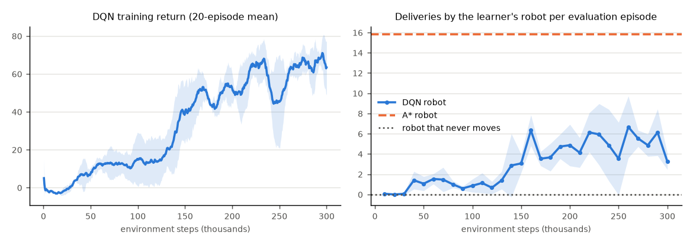

# Week 8 (part B): Double + Dueling DQN honest robot, training progress

```bash
python scripts/train_dqn.py --config configs/week8_dqn.yaml --seed 8100   # about 7 min on a laptop CPU; repeat per seed
python scripts/train_dqn.py --config configs/week8_dqn.yaml --report      # table + figure from the trained seeds
python scripts/train_dqn.py --smoke                                       # 1500 steps
```

Outputs: `results/summary/week8_dqn.csv`, `docs/media/week8_dqn_progress.png`. The per-episode curves and network weights stay in `results/week8_dqn/` (gitignored).

## Setup

- **Environment (`rl/fleet_env.py`).** Stock tiny, 4 robots, 500 steps, no saboteur. One robot (never the saboteur, drawn per episode from the seed) is the learner; the other three are the usual cooperative A* robots. The A* robots treat the learner as an obstacle and leave it out of the reservation table, because its moves are not planned.
- **Observation:** rware's local observation only (71 numbers: own position, direction, load, and a 3 x 3 window of robots, shelves and requests), as the proposal requires for learning agents.
- **Reward:** +10 per delivery, -0.01 per step, and +1 shaping for picking up a currently requested shelf.
  - The first smoke run showed reward hacking: picking up and dropping the same requested shelf earned a return of 80 with no delivery. The bonus is now paid once per shelf while it stays requested.
- **Episode ends:** these are time limits, so they are stored as non-terminal transitions.
- **Agent (`rl/dqn.py`):**
  - Network: dueling MLP (two hidden layers of 128 units).
  - Targets: Double DQN, Huber loss, Adam (lr 5e-4), gamma 0.99.
  - Replay: buffer of 100k transitions, batch 64, one gradient step every 2 environment steps after 5k warm-up steps.
  - Target network: hard sync every 2k steps.
  - Exploration: epsilon decays linearly from 1.0 to 0.05 over the first 150k of 300k steps.
- **Evaluation:** every 20 episodes, 5 fixed episodes (seeds 9000 to 9004) at epsilon 0.05.
  - Benchmark: an A* robot in the learner's slot on the same seeds.
  - Lower bound: a robot that never moves.
- **Seeds:** 3 training seeds (8100 to 8102).

## Results (300k steps per seed)

| robot in the learner's slot | its deliveries per episode | fleet deliveries (3 A* + this robot) |
|---|---|---|
| A* robot (benchmark) | 15.8 | 65.2 |
| DQN, last 100 training episodes (epsilon 0.05) | 6.3 ± 0.2 | 52.8 ± 0.2 |
| DQN, final evaluation | 3.3 ± 0.8 | 50.8 ± 1.1 |
| DQN, best evaluation during training | 8.1 ± 1.8 | |
| robot that never moves | 0.0 | 46.8 |

Mean ± std over the 3 seeds; the evaluation rows use 5 episodes per seed.



## Findings

- **The DQN robot learns to deliver from local observations alone.** It starts at 0 deliveries, passes 1 per episode after about 40k steps, and settles at about 4 to 6 per evaluation episode after 150k steps, when epsilon reaches its floor. All 3 seeds show the same shape.
- **It reaches about 40% of the A* robot** (6.3 against 15.8 deliveries in the last 100 training episodes). The fleet with a DQN robot delivers 52.8 against 65.2 with four A* robots. That is 6 more than with a robot that never moves (46.8), so the learner now adds to the fleet rather than getting in its way. A random robot in the same slot costs the fleet about 20 deliveries (smoke check: 46 and 44 in two episodes).
- **Training has not converged.** The return was still rising at 300k steps, and evaluation is noisy: 5 episodes per point, with dips of 2 to 4 deliveries between neighbouring points. Final-evaluation numbers are therefore less reliable than the training average.
- **The learner still wastes moves.** One seed picks up requested shelves 47 times per evaluation episode for 2.4 deliveries. It likely picks up and drops shelves it cannot yet carry to a goal. The bonus no longer pays for this, so it is inefficiency rather than reward hacking, but it is the first thing to look at.
- **Cost.** 300k steps take about 7 minutes per seed on a laptop CPU (about 710 steps per second, A* planning for the other three robots included). The three seeds ran in parallel.

## Next (Week 9)

- Train longer (1M to 2M steps) and evaluate on more episodes (20 or more) before comparing with A*.
- Run the limited hyperparameter search from the proposal (learning rate, gamma, epsilon schedule, shaping on/off) across seeds.
- Rerun under sabotage (`kind: goal_blocker` etc. in the config) and on the small map (`layout: small`, once PR #6 is merged) for the DQN vs. A* comparison.
