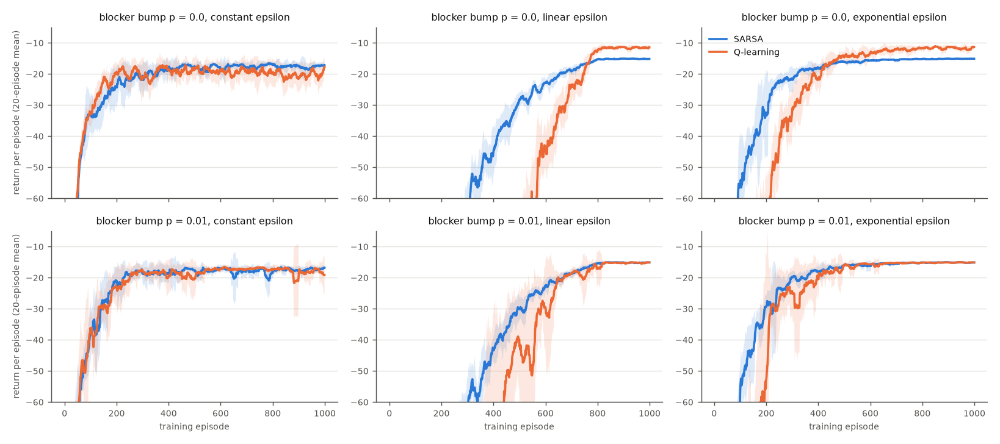
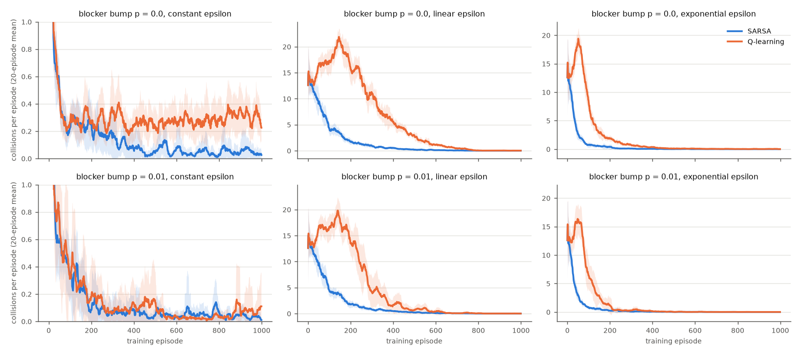
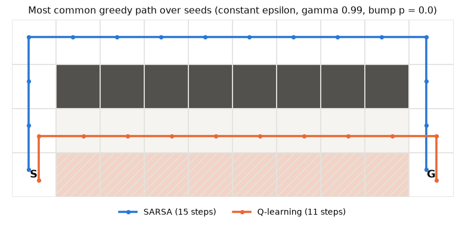

# Week 8 (part A): SARSA vs. Q-learning on a single-aisle gridworld

A controlled side experiment on on-policy vs. off-policy TD control, following the cliff-walking example in Sutton and Barto. Everything here is reproducible with:

```bash
python scripts/run_tabular.py --config configs/week8_tabular.yaml   # about 1 minute on a laptop
python scripts/run_tabular.py --smoke                               # 2 seeds, 50 episodes
```

Outputs: `results/summary/week8_tabular.csv` (one row per bump probability x method x schedule x gamma, mean and std over 10 seeds), `results/summary/week8_tabular_value_iteration.csv` and the figures in `docs/media/week8_*.png`.

## The MDP (`rl/gridworld.py`)

```
..........   row 0: detour
.xxxxxxxx.   row 1: shelves (impassable)
.aaaaaaaa.   row 2: 1-wide aisle next to the blocker
SbbbbbbbbG   row 3: the blocker's lane
```

- States: the robot's tile (40). Actions: up, right, down, left; a move into a wall or shelf leaves the robot in place.
- Reward: -1 per step. A collision with the blocker adds -20 and sends the robot back to S. Reaching G ends the episode. Training episodes are capped at 200 steps.
- Moving into the lane is a collision. Ending a step on an aisle tile is a collision with probability `bump_prob` (the blocker steps out of its lane). The blocker is memoryless, so the transition model is exact and small enough for value iteration.
- Collisions are the deadlock events of this experiment. The deadlock rate is the share of episodes with at least one collision (last 100 training episodes).
- Shortest routes: the aisle takes 11 steps, the detour 15.

## Design

- Methods: SARSA and Q-learning, alpha 0.1, 1000 episodes, Q initialised to 0, random tie-breaking.
- Exploration schedules: constant epsilon 0.1, and two decays from 1.0 to 0.01 over the first 80% of episodes, one linear and one exponential (geometric). The exponential decay spends much less time at high epsilon.
- Gamma sweep: 0.9, 0.95, 0.99 (figures use 0.99).
- Blocker: `bump_prob` 0 (only the lane is dangerous) and 0.01 (the aisle itself is also risky).
- 10 seeds per cell (8000 to 8009). The greedy policy of every trained agent is scored exactly by policy evaluation and compared with V* from value iteration (`rl/dp.py`).

## Value iteration (ground truth)

| bump_prob | gamma | V*(S) | optimal route |
|---|---|---|---|
| 0 | 0.90 / 0.95 / 0.99 | -6.86 / -8.62 / -10.47 | aisle |
| 0.01 | 0.90 | -7.94 | detour |
| 0.01 | 0.95 / 0.99 | -10.16 / -12.46 | aisle |

With bumps the aisle is still optimal for gamma >= 0.95, but only by 1.5 return (V* -12.46 against -13.99 for the detour at gamma 0.99). At gamma 0.9 the early collision risk outweighs the four saved steps.

## Results (gamma 0.99, mean ± std over 10 seeds)

Training columns use the last 100 episodes, where epsilon is still 0.1 under the constant schedule and 0.01 under both decays.

| bump | method | epsilon | greedy route (aisle share) | training return | collisions per ep. | deadlock rate | collisions over training | greedy policy value | V*(S) |
|---|---|---|---|---|---|---|---|---|---|
| 0 | Q-learning | constant | 1.0 | -19.7 ± 1.6 | 0.29 ± 0.06 | 0.23 ± 0.04 | 312 ± 10 | -10.47 | -10.47 |
| 0 | SARSA | constant | 0.0 | -17.8 ± 1.0 | 0.05 ± 0.03 | 0.05 ± 0.03 | 140 ± 12 | -13.99 | -10.47 |
| 0 | Q-learning | linear | 1.0 | -11.6 ± 0.3 | 0.02 ± 0.01 | 0.02 ± 0.01 | 6109 ± 193 | -10.47 | -10.47 |
| 0 | SARSA | linear | 0.0 | -15.2 ± 0.1 | 0.00 ± 0.00 | 0.00 ± 0.00 | 1371 ± 97 | -13.99 | -10.47 |
| 0 | Q-learning | exponential | 1.0 | -11.8 ± 0.4 | 0.03 ± 0.02 | 0.03 ± 0.01 | 1884 ± 103 | -10.47 | -10.47 |
| 0 | SARSA | exponential | 0.0 | -15.1 ± 0.1 | 0.00 ± 0.00 | 0.00 ± 0.00 | 433 ± 39 | -13.99 | -10.47 |
| 0.01 | Q-learning | constant | 0.1 | -18.2 ± 2.3 | 0.08 ± 0.13 | 0.06 ± 0.07 | 160 ± 33 | -13.84 ± 0.49 | -12.46 |
| 0.01 | SARSA | constant | 0.0 | -17.3 ± 0.4 | 0.03 ± 0.01 | 0.03 ± 0.01 | 138 ± 11 | -13.99 | -12.46 |
| 0.01 | Q-learning | linear | 0.0 | -15.3 ± 0.1 | 0.01 ± 0.01 | 0.01 ± 0.01 | 4610 ± 301 | -13.99 | -12.46 |
| 0.01 | SARSA | linear | 0.0 | -15.2 ± 0.1 | 0.00 ± 0.01 | 0.00 ± 0.01 | 1404 ± 103 | -13.99 | -12.46 |
| 0.01 | Q-learning | exponential | 0.0 | -15.2 ± 0.1 | 0.00 ± 0.01 | 0.00 ± 0.01 | 1539 ± 90 | -13.99 | -12.46 |
| 0.01 | SARSA | exponential | 0.0 | -15.2 ± 0.1 | 0.00 ± 0.00 | 0.00 ± 0.00 | 429 ± 30 | -13.99 | -12.46 |





## Findings

- **The hypothesis holds with a deterministic blocker.** With constant epsilon, Q-learning learns the optimal aisle in all 10 seeds and SARSA the detour in all 10. Because exploration continues, Q-learning collides about 6 times as often (0.29 against 0.05 per episode; deadlock rate 0.23 against 0.05) and earns a lower return while training (-19.7 against -17.8), even though its greedy policy is the better one. SARSA's values include its own exploration, so it keeps away from the lane.
- **Decaying epsilon reverses the training-return ranking.** Once epsilon is near 0, Q-learning's aisle pays off (-11.6 linear, -11.8 exponential, against -15.2 and -15.1 for SARSA). SARSA stays on the detour although its final epsilon is 0.01, because the detour was locked in while exploration was high. The price is paid early: Q-learning collides about 4.4 times as often over training as SARSA under either decay, mostly while epsilon is above 0.5.
- **The two decay schedules reach the same policies at very different cost.** Exponential decay leaves high epsilon quickly, so it cuts collisions over training by about 3 times against linear decay (Q-learning 1884 against 6109, SARSA 433 against 1371), with the same final routes and returns. Under an exploration budget, exponential decay is the better choice here.
- **The gamma sweep does not change the routes with a deterministic blocker.** Every Q-learning agent matches V* exactly at all three gammas and every SARSA agent learns the detour.
- **A stochastic blocker hides the optimal route from both learners.** With `bump_prob` 0.01, value iteration says the aisle is optimal at gamma 0.95 and 0.99, yet 119 of 120 agents in those cells learn the detour (one Q-learning seed, constant epsilon, finds the aisle). The aisle is only 1.5 better in expectation, each bump is a -21 sample, and once the detour is learned the aisle is rarely revisited, so its estimates stay pessimistic. In a check outside the main run, Q-learning reached the aisle in 5 of 5 seeds with alpha 0.02 and 10,000 episodes, and in 0 of 5 with alpha 0.05 and 5,000. So this is slow convergence under noise, not a different fixed point. For the fleet this suggests that a robot learning near an intermittent blocker may settle on a safe detour long before it could learn that the short route is better.
- **Cost.** Each agent trains in 0.1 to 0.3 s (18k to 68k environment steps). The whole grid of 360 agents takes about 1 minute.

## Limitations

- The blocker is memoryless and the state is only the robot's tile. A blocker that moves or responds to the robot would need its position in the state.
- Results depend on alpha and the episode budget, as the stochastic case shows; a full learning-rate sweep belongs to Week 9.
- Optional Monte Carlo control was not run.
